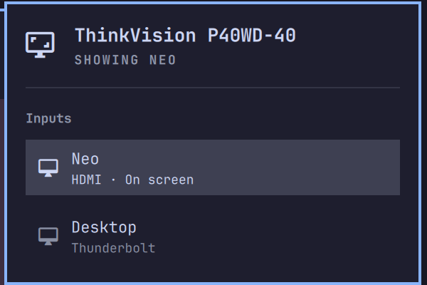

# eKVM

Switch your monitor's input from the Omarchy bar, so its built-in KVM moves
your keyboard and mouse to the other computer. No monitor buttons needed.



It talks to the monitor over DDC/CI with `ddcutil` (VCP `0x60`, input source).
Tested with a Lenovo ThinkVision P40wd-40.

- Left-click the bar icon to open the panel, then pick a computer. Arrow keys
  and Enter work too.
- Right-click the bar icon to switch straight to the next computer.

## Requirements

- `ddcutil` (`sudo pacman -S ddcutil`)
- Access to `/dev/i2c-*`: add yourself to the `i2c` group and load `i2c-dev`.
- Install the plugin on every computer connected to the monitor, so you can
  switch back from whichever one is on screen.

## Settings

Set these on the widget's entry in `~/.config/omarchy/shell.json`:

```json
{
  "id": "io.github.douglas.omarchy-ekvm",
  "model": "P40WD-40",
  "inputs": [
    { "label": "Laptop", "value": "0x11", "host": "laptop" },
    { "label": "Desktop", "value": "0x31", "host": "desktop" }
  ]
}
```

- `model` matches the name from `ddcutil detect`.
- `value` is the monitor input. Find yours with
  `ddcutil --model <model> capabilities` (look under `Feature: 60`). On the
  P40wd-40, `0x11` is HDMI, `0x0f` is DisplayPort, and `0x31` is Thunderbolt.
- `host` (optional) is an SSH host. When you switch to that input, eKVM turns
  that computer's display back on (`omarchy-brightness-display on`), so a
  screen that went idle isn't left black. Key-based SSH login must work
  without a prompt.
- `icon` (optional) is a Nerd Font glyph for the input's row.

## Keyboard shortcut

Bind this in Hyprland to switch to the next computer:

```bash
omarchy-shell io.github.douglas.omarchy-ekvm.input next
```

`omarchy-shell io.github.douglas.omarchy-ekvm toggle` opens or closes the panel.

## Install

```bash
omarchy plugin add https://github.com/douglas/omarchy-ekvm.git --enable
```

## Remove

```bash
omarchy plugin remove io.github.douglas.omarchy-ekvm
```

Then delete its entry from `~/.config/omarchy/shell.json` if you added settings.

## Development

```bash
omarchy plugin validate .
/usr/lib/qt6/bin/qmllint -I "$OMARCHY_PATH/shell" Widget.qml
```
